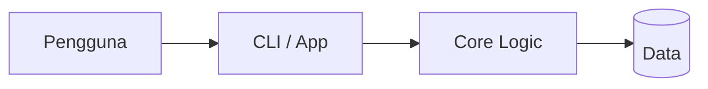

# Dezz Osint

Dezz Osint — project oleh Nabil Aulia Dika (dezzorigin).

## Status Proyek

**Selesai (production-ready)** _(README ada, build artifact ada, ada folder test)_

## 📋 Tech Stack

Python

## 🏗️ Arsitektur



## 📁 Struktur Proyek

```
Data/
assets/
dezz/
dezz_osint.egg-info/
reports/
server/
skills/
tests/
LICENSE
PRD.md
README.md
dezz.py
install.sh
mcp.json
pyproject.toml
requirements.txt
```

## 🚀 Getting Started

```bash
# Install dependencies
npm install

# Jalankan development server
npm run dev
```

> Untuk project HTML/Python/Go, lihat instruksi di atas atau file konfigurasi.

## 📄 Lisensi

MIT — lihat [LICENSE](./LICENSE).

---
_Dikembangkan oleh **dezzorigin** (Nabil Aulia Dika)._
